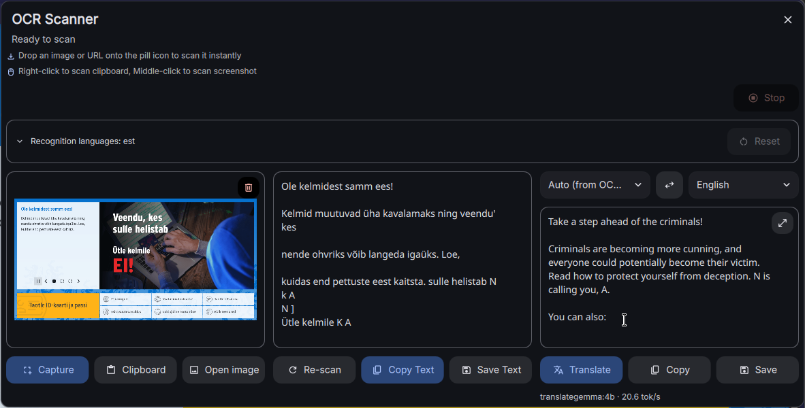

# DMS Translator

A DankMaterialShell widget that translates text locally, and can OCR the screen to get it.



A [DankMaterialShell](https://github.com/AvengeMedia/DankMaterialShell) bar plugin that reads text from the screen, the
clipboard or an image file with [Tesseract](https://github.com/tesseract-ocr/tesseract), and translates it with a
**local** model on an Ollama-compatible server. It also works as a plain translator: type or paste text, no picture
needed.

Translation runs on your own machine: [Ollama](https://ollama.com) with
[TranslateGemma](https://ollama.com/library/translategemma), or
[Local LLM NPU Translator](https://github.com/iNViTiON/local-llm-npu-translator), which serves the same model on an
Intel NPU. The prompt and model handling follow the [Llama Franca](https://github.com/iNViTiON/llama-franca) browser
extension, so all three share one server and one model.

It started as a fork of the **OCR Scanner** plugin by Loc Huynh
([hthienloc/dms-plugins](https://github.com/hthienloc/dms-plugins), folder `ocrScanner`), and uses its own plugin id,
`ocrTranslate`, so both can be installed side by side.

## Features

**Scanning**

- Three sources: **Capture** a screen region, scan the **Clipboard** image, or **Open image** (PNG, JPEG, WebP or
  BMP). Bar icon shortcuts: middle-click captures, right-click scans the clipboard, and dropping an
  image file (SVG too) or an image URL on the icon scans it.
- **Recognition languages per session**: the settings hold the default list; a picker in the window adds or removes
  languages until the shell restarts or you press Reset. Fewer languages scan faster: Tesseract runs every selected
  model, and a dozen languages take 10-30 s.
- **Re-scan**, also while a scan is running: the running one is stopped and the new language list is used.
- **Thai**: Tesseract's Thai model puts a space between nearly every character (vowel and tone marks look like they
  float). The plugin removes spaces between Thai characters; there is a setting to turn this off.
- Clear errors instead of "Tesseract failed": a missing language pack, a timeout with too many languages, an unreadable
  image, an empty clipboard, a cancelled capture. The window shows how long the scan has been running.

**Translation**

- A third column next to the image and the recognised text: From and To pickers, a **swap** button (swaps the
  languages and the two texts, for using it as a translator in both directions), and Translate, Copy and Save.
- **From: Auto** recognises the language from its script for Thai, Japanese, Korean, Chinese, Greek, Hebrew, Arabic,
  Hindi, Bengali, Burmese, Khmer, Lao and (as Russian) Cyrillic. Latin-script text could be any language, so it falls
  back to the first recognition language; pick From for other languages.
- **Streams**: the translation appears as the model writes it. The box follows the end of the text, unless you scroll
  up to read an earlier part.
- **Translates by itself** after every scan, and 1.2 s after you stop typing or pasting in the text box (both can be
  turned off). A newer request always stops the running one first.
- **Long text** goes in pieces of up to 900 characters, one request each. Each piece is cached, so editing one line of
  a long text translates only that piece again.
- **Stop** button for everything running (scan, translation, a pending capture), and a **maximize** button for long
  translations.
- Auto-copy can copy the translation or the scanned text.

## Requirements

- DankMaterialShell (tested with 1.6.3) on Wayland.
- `tesseract` with the language data you need, `wl-clipboard` (`wl-paste`), `file`, and `procps` (`pkill`).
  For SVG files, `rsvg-convert` (librsvg) or ImageMagick.
- For translation, an Ollama-compatible server on `http://localhost:11434` (changeable in the settings):
  - Ollama: `ollama pull translategemma:4b`. Other models work too, but the prompt is written for TranslateGemma.
  - or [Local LLM NPU Translator](https://github.com/iNViTiON/local-llm-npu-translator) on an Intel NPU. Its model
    names ending in `@NPU`, `@GPU` or `@CPU` pick the device.

## Install

```bash
git clone https://github.com/iNViTiON/dms-ocr-translate ~/.config/DankMaterialShell/plugins/ocrTranslate
```

Then in DMS: **Settings → Plugins**, enable **OCR Translate**, and add it to the bar in **Settings → DankBar → Add
Widget**. Open its settings to choose the recognition languages, the server and the model.

**NixOS** with the DankMaterialShell module, as a flake input:

```nix
# flake.nix
inputs.dms-ocr-translate = {
  url = "github:iNViTiON/dms-ocr-translate";
  flake = false;
};

# a NixOS module
programs.dms-shell.plugins.ocrTranslate.src = inputs.dms-ocr-translate;
environment.systemPackages = with pkgs; [
  (tesseract.override { enableLanguages = [ "eng" "tha" ]; })
  wl-clipboard
  file
  procps
  librsvg
];
```

The plugin keeps its scratch files in `~/.cache/dms-ocr`.

**Keyboard shortcut**: the plugin answers to `dms ipc call ocrTranslate capture` (pick a screen region, scan it and
open the window), `clipboard` (scan the clipboard image) and `toggle` (open or close the window). Bind one in your
compositor, for example in niri:

```kdl
binds {
    // ThinkPad X1 Carbon: the snip key (Fn+F10) sends XF86LinkPhone
    XF86LinkPhone hotkey-overlay-title="OCR and translate a screen region" { spawn "dms" "ipc" "call" "ocrTranslate" "capture"; }
}
```

**Updating**: DMS keeps `Translator.js` loaded for the whole session, so after an update run `dms restart`. A plugin
reload (`dms ipc call plugins reload ocrTranslate`) only picks up changes to the `.qml` files.

## Settings

| Setting | Default | |
|---|---|---|
| Recognition languages | `eng` | Tesseract languages to scan with; the window can change them for the session |
| Auto-copy to clipboard | on | copy after a scan |
| Remove spaces inside Thai words | on | see Thai above; real spaces between Thai phrases are removed too |
| Server | `http://localhost:11434` | Ollama-compatible server |
| Model | `translategemma:4b` | listed from the server |
| Translate into | English | also changeable in the window |
| Translate after every scan | on | |
| Translate while typing | on | 1.2 s after the last change |
| Auto-copy | Translation | which text auto-copy copies when translating after every scan |

The prompt is TranslateGemma's template from Ollama's library. A `prompt` key in the plugin's settings overrides it
(placeholders `{source}`, `{source_code}`, `{target}`, `{target_code}`, `{text}`); there is no field for it in the
settings page yet.

## How it works

- `OCRWidget.qml`: the bar icon and the window. Tesseract runs through a small shell wrapper that returns its error
  output too (DMS passes back only a command's standard output and exit code) and records its process id, so a scan
  can be stopped.
- `Translator.js`: the translation client, ported from Llama Franca: `POST /api/chat` with `stream: true`,
  TranslateGemma's prompt, `temperature: 0` and a length cap, read line by line while the answer arrives. It also holds
  the language list, the Thai spacing fix, the text splitting and the script detection.
- `OCRSettings.qml`: the settings page.

## Credits and license

MIT, see [LICENSE](LICENSE). Based on OCR Scanner by Loc Huynh
([hthienloc/dms-plugins](https://github.com/hthienloc/dms-plugins), MIT), imported from commit `fcbea51f`; the
interface translations in `translations/` come from there. The translation prompt and model handling follow
[Llama Franca](https://github.com/Th1nkK1D/llama-franca) (MIT).
